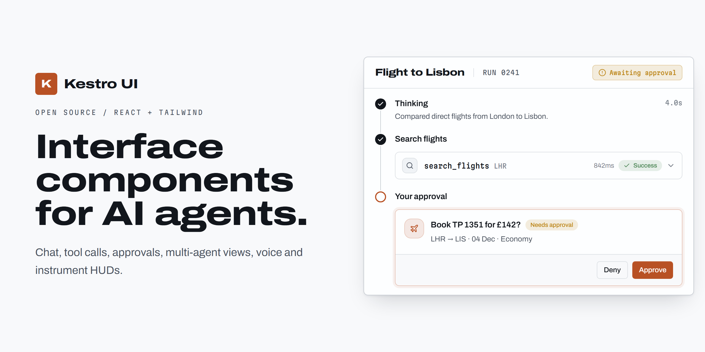
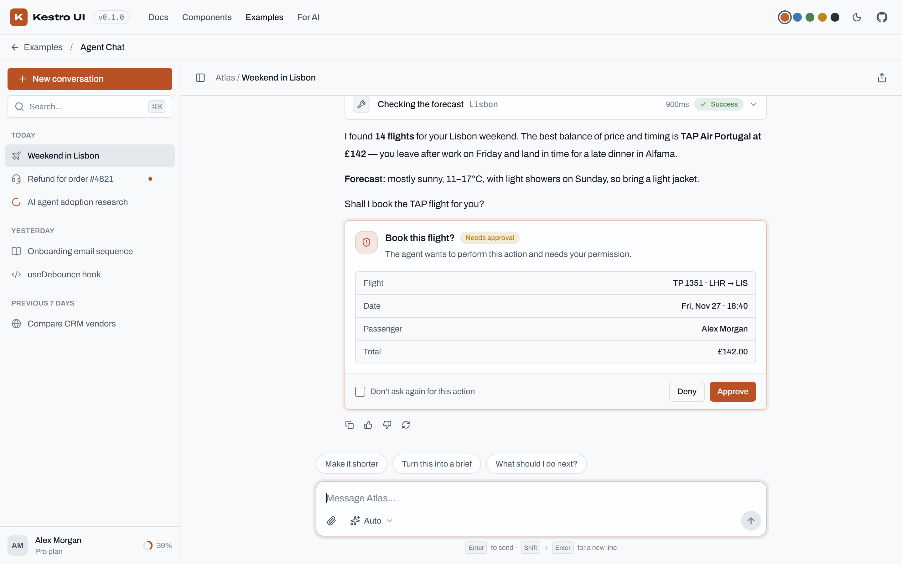
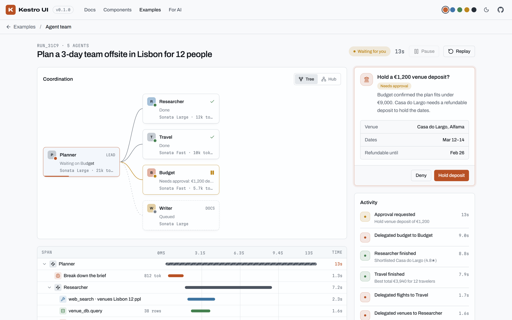
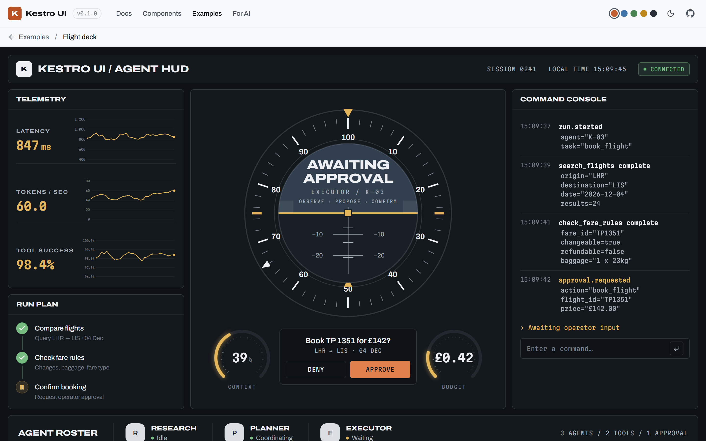
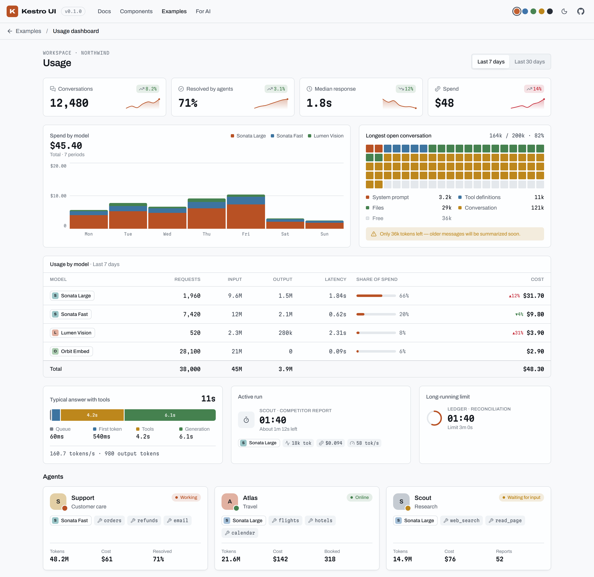

<p align="center">
  
</p>

<p align="center">
  <a href="https://www.npmjs.com/package/kestro-ui"></a>
  <a href="./LICENSE"></a>
  
  
  
</p>

<p align="center">
  <a href="https://himasrafeek.github.io/kestro-ui/"><b>Documentation</b></a> ·
  <a href="https://himasrafeek.github.io/kestro-ui/#/components/agent-chat">Components</a> ·
  <a href="https://himasrafeek.github.io/kestro-ui/#/examples">Examples</a> ·
  <a href="https://himasrafeek.github.io/kestro-ui/llms-full.txt">llms-full.txt</a>
</p>

---

**Kestro UI** is a React + Tailwind CSS component library for building interfaces for AI agents: assistants, support bots, research and booking agents, operations workflows, multi-agent systems, voice assistants and instrument-style HUDs.

Agents do more than chat. They reason, call tools, ask before acting, cite sources, hand work to other agents and talk out loud. Kestro UI gives each of those moments a component that is accessible, themeable and works with any backend.

<table>
  <tr>
    <td width="50%"><br /><sub><b>Agent chat</b>: reasoning, tool calls, generative UI and approvals</sub></td>
    <td width="50%"><br /><sub><b>Agent team</b>: an orchestrator delegating to four agents, with a live trace</sub></td>
  </tr>
  <tr>
    <td width="50%"><br /><sub><b>Flight deck</b>: attitude indicator, telemetry and an event log</sub></td>
    <td width="50%"><br /><sub><b>Usage dashboard</b>: tokens, spend and latency per model and agent</sub></td>
  </tr>
</table>

## Features

- **One component or a hundred.** `<AgentChat />` renders a complete agent chat. Every piece inside it is exported, so you can compose your own layout.
- **Any backend.** Messages use a `parts` format compatible with the Vercel AI SDK `useChat()`, and plain `{ role, content }` objects work too.
- **Human in the loop.** Approvals for payments, emails, bookings and deletions, structured questions, plans with live progress, and hand-off to a person.
- **Multi-agent views.** `AgentGraph` (tree), `AgentHub` (hub-and-spoke) and `TraceTree` (nested LLM/tool spans with a live timeline). Click any agent for its activity, model, token usage and steps.
- **Usage, cost and time.** Token breakdowns, context windows, per-model usage tables, spend charts, run timers, latency breakdowns and tiny inline chips for every metric.
- **Tasks.** A task creator (schedule, permissions, budget), a drag-and-drop task board and a task list.
- **Voice and instruments.** `VoicePanel`, `AttitudeIndicator`, gauges, telemetry charts, an event log and a command console. All of them react to real microphone input.
- **Smooth streaming.** `StreamingMarkdown` paces bursty token streams into an even reveal. Motion respects `prefers-reduced-motion`.
- **No heavy dependencies.** Markdown, syntax highlighting and citations are built in, and nothing uses `dangerouslySetInnerHTML`.
- **Docs for AI coding assistants.** `llms.txt`, `llms-full.txt`, an `AGENTS.md` inside the package, and a *Copy for AI* button on every docs page.

## Quick start

```bash
npm install kestro-ui
```

Add the theme after Tailwind in your stylesheet:

```css
@import "tailwindcss";
@import "kestro-ui/theme.css";
```

Not using Tailwind? Import the compiled CSS instead: `import "kestro-ui/styles.css"`.

```tsx
import { useState } from "react";
import { AgentChat, type ChatMessage } from "kestro-ui";

export default function App() {
  const [messages, setMessages] = useState<ChatMessage[]>([]);

  return (
    <div className="h-dvh">
      <AgentChat
        messages={messages}
        agent={{ name: "Atlas", description: "Travel concierge" }}
        suggestions={["Plan a weekend in Lisbon", "Find a quiet hotel"]}
        onSend={(text) => setMessages((m) => [...m, { id: crypto.randomUUID(), role: "user", content: text }])}
      />
    </div>
  );
}
```

### With the Vercel AI SDK

```tsx
import { useChat } from "@ai-sdk/react";
import { AgentChat } from "kestro-ui";

export function Chat() {
  const { messages, status, sendMessage, stop } = useChat();
  return <AgentChat messages={messages} status={status} onSend={(text) => sendMessage({ text })} onStop={stop} />;
}
```

See [Connect your agent](https://himasrafeek.github.io/kestro-ui/#/docs/backends) for SSE, WebSockets, LangGraph and custom tool UIs.

## Components

| Area | Components |
|---|---|
| Chat | `AgentChat` `Thread` `Message` `MessageActions` `MessageParts` `Markdown` `StreamingMarkdown` `CodeBlock` `TypingIndicator` |
| Input | `PromptInput` `ModelSelector` `Suggestions` `EmptyState` `Attachment` |
| Transparency | `Reasoning` `ToolCall` `ToolCallRow` `Sources` `SourceChip` `InlineCitation` |
| Human in the loop | `ToolApproval` `AgentQuestion` `HandoffBanner` |
| Tasks | `TaskCreator` `TaskBoard` `TaskCard` `TaskList` |
| Usage & cost | `TokenUsage` `ContextWindow` `ModelUsageTable` `UsageChart` `StatTile` `TokenCounter` |
| Time | `RunTimer` `LatencyBreakdown` `TimeAgo` |
| Agents & models | `AgentCard` `AgentPicker` `ModelCard` `ModelCompare` `ModelBadge` |
| Tiny chips | `CostTag` `LatencyTag` `DurationTag` `TokensPerSecond` `RequestCount` `TrendTag` `ContextPill` `MiniBar` `AgentChip` `CapabilityTags` `MessageMeta` |
| Workflows | `RunCard` `TaskPlan` `AgentHeader` `UsageMeter` `SegmentedMeter` `ActivityFeed` `Artifact` `ConversationList` |
| Multi-agent | `AgentGraph` `AgentHub` `AgentDetails` `TraceTree` `AgentAvatar` `AgentRoster` `AgentHandoff` |
| Images | `ImageGallery` `ImagePreview` `Lightbox` |
| Voice | `VoicePanel` `VoiceOrb` `VoiceDial` `VoiceWave` `useMicrophone` `useAudioAnalyser` |
| HUD | `AttitudeIndicator` `AgentCore` `HudPanel` `RadialGauge` `TelemetryChart` `HudStat` `Sparkline` `Waveform` `EventLog` `CommandConsole` `BootSequence` `DataTicker` |
| Embed | `ChatWidget` |
| Primitives | `Button` `IconButton` `Badge` `StatusDot` `Spinner` `Tooltip` `Kbd` `Card` `ShimmerText` `Collapse` `Switch` `SegmentedControl` |

Every component has a live example, its source and a full props table in the [documentation](https://himasrafeek.github.io/kestro-ui/).

## Theming

All colors, radii and shadows are CSS variables, so you can re-theme with a few lines:

```css
:root {
  --kui-accent: oklch(0.56 0.1 148);
  --kui-radius: 0.5rem;
}
```

Dark mode follows a `.dark` class on any ancestor. For the slate-and-rufous palette used on the docs site, add `data-kui-palette="kestro"` to `<html>`.

## Using with AI coding assistants

Point your assistant at the full docs:

```text
Use the Kestro UI component library: https://himasrafeek.github.io/kestro-ui/llms-full.txt
```

The npm package also ships `AGENTS.md` and `llms-full.txt`, so tools that read `node_modules` find the API offline.

## Requirements

- React 18 or 19
- Tailwind CSS v4, or the pre-compiled stylesheet
- Evergreen browsers: the theme uses `oklch()`, `color-mix()` and container queries

## Development

```bash
pnpm install
pnpm dev          # docs site at http://localhost:5173
pnpm build:lib    # library → packages/kestro-ui/dist
pnpm typecheck
```

The repository contains the library (`packages/kestro-ui`) and the documentation site (`apps/docs`), which also holds every example.

## Contributing

Kestro UI is designed and maintained by one person, and **pull requests are not accepted**. Bug reports and feature requests are welcome as [issues](https://github.com/HimasRafeek/kestro-ui/issues). See [CONTRIBUTING.md](./CONTRIBUTING.md).

To report a vulnerability, follow [SECURITY.md](./SECURITY.md).

## License

[MIT](./LICENSE) © Kestro
