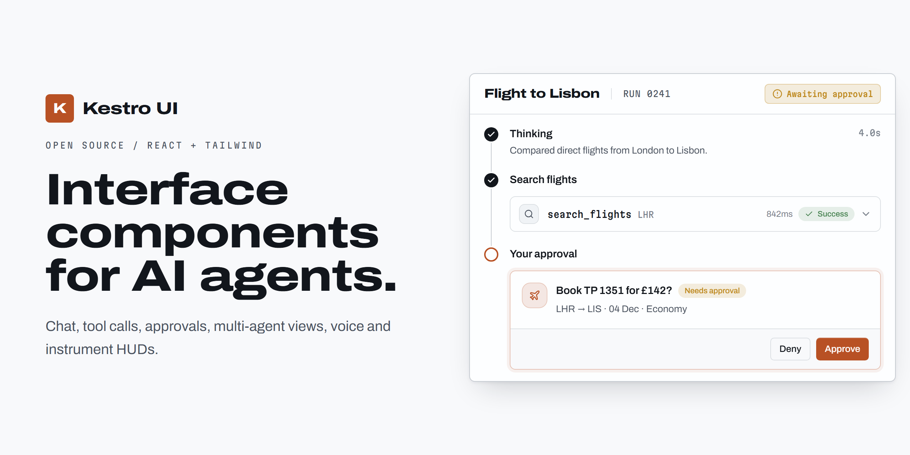

<p align="center">
  
</p>

# kestro-ui

React + Tailwind CSS components for AI agent interfaces: chat, reasoning, tool calls, approvals, multi-agent views, voice and instrument HUDs.

**[Documentation](https://himasrafeek.github.io/kestro-ui/)** · [Components](https://himasrafeek.github.io/kestro-ui/#/components/agent-chat) · [Examples](https://himasrafeek.github.io/kestro-ui/#/examples) · [GitHub](https://github.com/HimasRafeek/kestro-ui)

## Install

```bash
npm install kestro-ui
```

```css
/* with Tailwind CSS v4 */
@import "tailwindcss";
@import "kestro-ui/theme.css";
```

Without Tailwind, import the compiled stylesheet once: `import "kestro-ui/styles.css"`.

## Use

```tsx
import { AgentChat } from "kestro-ui";

<div className="h-dvh">
  <AgentChat messages={messages} status={status} onSend={(text) => send(text)} />
</div>;
```

Messages are `{ id, role, content }` or `{ id, role, parts }`, compatible with the Vercel AI SDK `useChat()`. Every piece of `AgentChat` is also exported on its own: `Reasoning`, `ToolCall`, `ToolApproval`, `PromptInput`, `TaskPlan`, `AgentGraph`, `TraceTree`, `AttitudeIndicator` and more than 100 others.

## For AI coding assistants

This package ships `AGENTS.md` (usage rules) and `llms-full.txt` (complete docs with props for every component). Online: https://himasrafeek.github.io/kestro-ui/llms-full.txt

## License

MIT © Kestro
